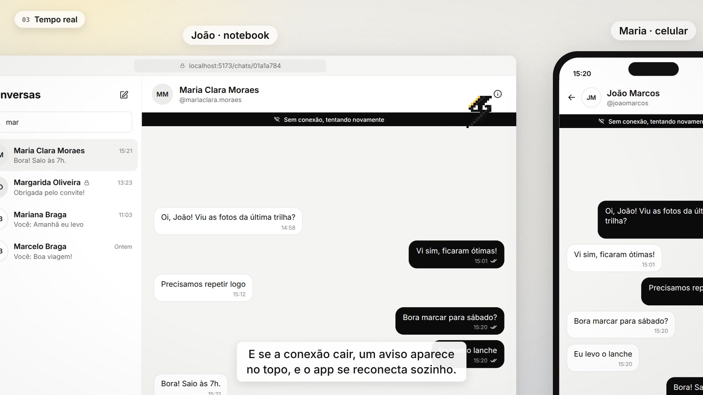
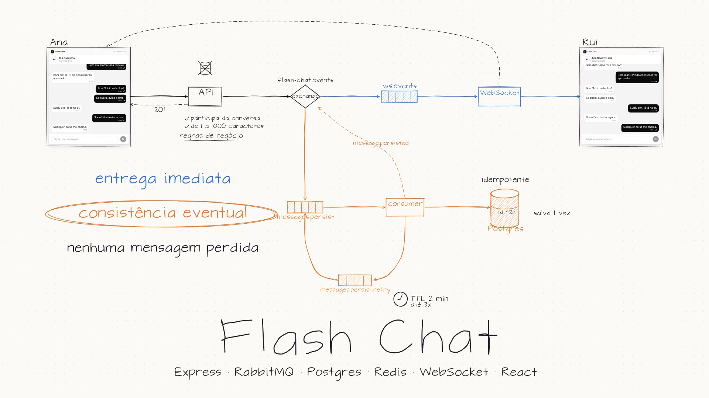
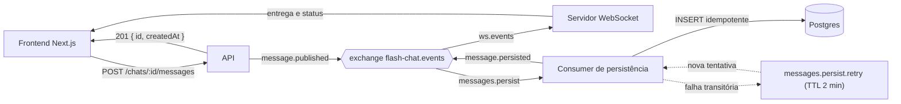

# Flash Chat

Chat em tempo real para conversas diretas e em grupo. A mensagem é entregue a quem está conectado no mesmo instante e gravada no banco de forma assíncrona, por uma fila. Assim a conversa continua fluindo mesmo quando o banco está lento ou fora do ar, e nenhuma mensagem se perde.

## Vídeos

| Tour pelo produto (2 min 9 s) | Arquitetura e consistência eventual (2 min 18 s) |
|---|---|
| [](docs/videos/tour.mp4) | [](docs/videos/arquitetura.mp4) |
| Login e cadastro, lista de conversas, conversa somente leitura, tempo real entre notebook e celular, status das mensagens, nova conversa por Nickname e criação de grupos. | O caminho de uma mensagem pela API, pelo RabbitMQ, pelo WebSocket e pelo consumer de persistência, e o que acontece quando o Postgres cai. |

## Funcionalidades

- Cadastro e login com e-mail e senha, sessão com access token em memória e refresh token em cookie `httpOnly`.
- Conversas diretas e grupos (de 2 a 49 pessoas além de quem cria), com busca por nome ou Nickname.
- Entrega em tempo real por WebSocket, com reconexão automática e aviso de conexão na tela.
- Status de cada mensagem enviada: enviando (relógio), enviada (um check) e salva (dois checks).
- Conversa somente leitura quando a outra pessoa desativa a conta: o histórico continua visível, mas não aceita novas mensagens.
- Layout responsivo: no celular, a lista e a conversa ocupam a tela inteira, uma de cada vez.

## Arquitetura

O backend roda em três processos que compartilham o mesmo código e se comunicam pelo RabbitMQ:

| Processo | Papel |
|---|---|
| API HTTP (Express) | Autenticação, usuários, conversas e envio de mensagens. Valida toda regra de negócio e publica o evento, sem gravar a mensagem. |
| Servidor WebSocket (`ws`) | Mantém as conexões dos usuários e entrega os eventos aos participantes conectados. |
| Consumer de persistência | Lê a fila de persistência e grava as mensagens no Postgres. |



O caminho de uma mensagem:

1. O frontend envia a mensagem e mostra o relógio (Pending).
2. A API valida a regra de negócio (participante da conversa, conversa não somente leitura, de 1 a 1000 caracteres), gera o id (UUIDv7) e publica `message.published` no exchange `flash-chat.events`. A resposta `201` só sai depois da confirmação do broker, e o remetente vê um check (Published).
3. A fila `ws.events` leva o evento ao servidor WebSocket, que entrega a mensagem aos participantes conectados.
4. Em paralelo, a fila `messages.persist` leva o mesmo evento ao consumer, que grava no Postgres e publica `message.persisted`. O remetente vê dois checks (Persisted).

Essa separação dá consistência eventual entre a entrega e o histórico:

- Como as regras de negócio são validadas na API antes de publicar, o consumer só encontra falhas transitórias. Ele tenta de novo por uma fila de retry com TTL de 2 minutos, em até 3 tentativas. O que esgota as tentativas vai para a DLQ.
- O INSERT é idempotente pelo id, então uma reentrega nunca duplica a mensagem.
- A última mensagem de cada conversa só avança, mesmo quando as gravações chegam fora de ordem.
- Toda entrega passa pelo exchange, mesmo com uma única instância de WebSocket.


## Decisões técnicas

### Filas e consistência eventual

A API não grava a mensagem no banco. Ela valida, gera o id e publica o evento `message.published` no RabbitMQ. Só responde depois que o broker confirma o recebimento. A partir daí o evento segue por dois caminhos independentes: o servidor WebSocket entrega a mensagem aos participantes e o consumer de persistência grava no Postgres.

Benefícios:

- A entrega não espera o banco. Uma escrita lenta ou o Postgres fora do ar não atrasa a conversa.
- Uma falha no banco não perde mensagem. O evento vai para a fila de retry (TTL de 2 minutos, até 3 tentativas). Se as tentativas acabarem, ele termina na DLQ, onde pode ser inspecionado.
- Cada processo escala e cai de forma isolada, porque os três só se comunicam pelo broker.

Trade-offs:

- Por alguns instantes, a mensagem já foi entregue e ainda não está no histórico. Para deixar esse intervalo visível, o remetente acompanha os estados Pending, Published e Persisted.
- Reentregas acontecem, então o INSERT precisa ser idempotente pelo id. Pelo mesmo motivo, a Last Message só pode avançar.
- Tem mais coisa para operar e observar (exchange, filas, retry, DLQ), e um bug fica mais difícil de rastrear do que numa escrita direta.

### Busca full-text

As buscas de usuários e de conversas usam o full-text search do próprio Postgres (`to_tsvector`), com índices GIN, em vez de `LIKE '%termo%'`. Cada palavra digitada vira um prefixo e todas precisam casar, então "joa mar" encontra "João Marcos". Nomes e Nicknames usam a configuração `simple`, sem stemming, porque não faz sentido reduzir nome próprio à raiz. Já o índice de mensagens está pronto em `portuguese`, com stemming.

Benefícios:

- A consulta usa índice, então não varre a tabela inteira.
- Não depende de nenhum serviço extra, como Elasticsearch: o recurso já vem no banco.

Trade-offs:

- A expressão da consulta precisa ser idêntica à do índice. Caso contrário, o Postgres ignora o índice sem avisar.
- Esses índices de expressão são escritos à mão na migration, porque o TypeORM não consegue gerá-los.
- Não há tolerância a erro de digitação nem ranking sofisticado. Para isso, o próximo passo seria `pg_trgm` ou um motor de busca dedicado.

### UUIDv7

Todos os ids são UUIDv7, gerados na aplicação. O v7 carrega um timestamp nos primeiros bits, então os ids saem em ordem cronológica.

Benefícios:

- A API gera o id da mensagem antes de ela existir no banco. Esse mesmo id viaja no evento e serve de chave para o INSERT idempotente do consumer.
- A paginação é por cursor no próprio id (`id < cursor`, ordenado por id), sem coluna extra e sem os problemas do `OFFSET`.
- A Last Message avança comparando ids, e a lista de conversas ordena por eles.
- A inserção sai em ordem no índice da chave primária, o que fragmenta menos que o UUIDv4.

Trade-offs:

- Ocupa 16 bytes, o dobro de um `bigint`.
- O id revela o instante de criação.
- A ordem depende do relógio da máquina que gera o id: com várias instâncias, uma diferença de relógio pode inverter a ordem de duas mensagens muito próximas.

### Testes de integração

Os testes de integração sobem Postgres, RabbitMQ e Redis reais com Testcontainers, aplicam as mesmas migrations do ambiente real e chamam as rotas com Supertest. Os unitários cobrem as regras dos use cases com mocks.

Benefícios:

- Testam o que mock não alcança: os índices GIN, as constraints de unicidade, o INSERT idempotente, o retry e a DLQ do RabbitMQ, e os eventos publicados no exchange.
- O schema vem das migrations, então se uma migration estiver quebrada, o teste falha.
- Rodam no CI a cada push na `main`, em paralelo aos unitários.

Trade-offs:

- São mais lentos e precisam de Docker, tanto na máquina quanto no CI.
- Rodam em série, com as tabelas truncadas antes de cada teste, então a suíte fica mais longa conforme cresce.


## Stack

### Backend

| Área | Tecnologia |
|---|---|
| Linguagem e runtime | TypeScript 5.9 em Node.js 24 |
| HTTP | Express 5, com CORS, `cookie-parser` e `express-rate-limit` |
| Tempo real | WebSocket com a biblioteca `ws` |
| Mensageria | RabbitMQ 4.1 (`amqplib`), com exchange topic, filas duráveis, retry com TTL e DLQ |
| Banco de dados | PostgreSQL 16 com TypeORM 0.3 e migrations |
| Cache | Redis 7 |
| Autenticação | JWT (`jsonwebtoken`) e senhas com `bcryptjs` |
| Validação | Zod 4 |
| Logs | Pino |
| Testes | Vitest e Supertest, com testes de integração em containers |

### Frontend

| Área | Tecnologia |
|---|---|
| Framework | Next.js 16 (App Router) e React 19 |
| Estilo | Tailwind CSS 4 e ícones `lucide-react` |
| Dados do servidor | TanStack Query 5 e Axios |
| Estado local | Zustand 5 |
| Formulários | React Hook Form e Zod 4 |

### Infraestrutura

Docker Compose para Postgres, Redis, RabbitMQ e os três processos do backend, e Traefik para o deploy. A pipeline de testes do backend roda no GitHub Actions.

## Como rodar localmente

Pré-requisitos: Git, Docker com Docker Compose, Make, [nvm](https://github.com/nvm-sh/nvm) (Node 24) e Yarn 1.

1. Clone o repositório:

   ```bash
   git clone git@github.com:JoaoMarcosCS/flash-chat.git
   cd flash-chat
   ```

2. Crie os arquivos de ambiente:

   ```bash
   cp backend/.env.example backend/.env
   cp frontend/.env.example frontend/.env.local
   ```

   Substitua o conteúdo do `backend/.env` por estes valores de desenvolvimento:

   ```env
   API_PORT=3000
   WS_PORT=3001
   ENVIRONMENT=local
   NODE_VERSION=24.12.0

   DB_HOST=localhost
   DB_PORT=5432
   DB_USER=flashchat
   DB_PASS=flashchat
   DB_NAME=flashchat

   REDIS_HOST=localhost
   REDIS_PORT=6379

   LOG_LEVEL=info

   JWT_SECRET=dev-only-access-secret-change-me-in-production
   JWT_EXPIRES_IN=15m

   JWT_REFRESH_SECRET=dev-only-refresh-secret-change-me-in-production
   JWT_REFRESH_EXPIRES_IN=7d

   RABBITMQ_HOST=localhost
   RABBITMQ_PORT=5672
   RABBITMQ_MANAGEMENT_PORT=15672
   RABBITMQ_USER=flashchat
   RABBITMQ_PASS=flashchat
   ```

   O `frontend/.env.local` já vem pronto do exemplo:

   ```env
   NEXT_PUBLIC_API_URL=http://localhost:3000/api/v1
   NEXT_PUBLIC_WS_URL=ws://localhost:3001
   ```

   Os hosts ficam como `localhost` porque as migrations, o seed e o frontend rodam na sua máquina. Dentro dos containers, o `docker-compose.yml` troca `DB_HOST`, `REDIS_HOST` e `RABBITMQ_HOST` pelos nomes dos serviços. Os segredos JWT acima servem só para desenvolvimento: em produção, gere valores próprios (por exemplo, com `openssl rand -hex 32`).

3. Instale as dependências:

   ```bash
   (cd backend && nvm install && yarn install)
   (cd frontend && nvm install && yarn install)
   ```

   Mesmo com os serviços em Docker, esse passo é necessário. A API, o WebSocket e o consumer rodam em containers, e as imagens instalam as próprias dependências no build. Mas o `make dev` roda as migrations e o seed direto na sua máquina (com o TypeORM e o ts-node do backend), e o frontend também roda fora do Docker, com `yarn dev`. As dependências do backend também ativam o hook do Husky e o lint no editor.

4. Suba tudo:

   ```bash
   make dev
   ```

   O `make dev` sobe o Postgres, roda as migrations e o seed, sobe o Redis e o RabbitMQ, inicia a API, o WebSocket e o consumer em containers e, por fim, abre o frontend com os logs de todos os processos no terminal. O seed só roda com o banco vazio.

5. Acesse [http://localhost:5173](http://localhost:5173) e entre com a conta de demonstração criada pelo seed:

   - E-mail: `jmcsjoaomarcos@gmail.com`
   - Senha: `#Demo2026`

   Para testar o tempo real, abra uma segunda janela anônima, crie outra conta em "Criar conta" e converse entre as duas.

Portas usadas: frontend em `5173`, API em `3000`, WebSocket em `3001`, Postgres em `5432`, Redis em `6379` e RabbitMQ em `5672` (painel em [http://localhost:15672](http://localhost:15672)).

Para parar os containers, use `make down`.

## Testes

O backend tem duas suítes de testes no Vitest, separadas por configuração.

### Testes unitários

```bash
cd backend
yarn test
```

Ficam ao lado do código (`*.spec.ts` dentro de `src/modules` e `src/shared`) e testam os use cases isolados. Cada use case recebe as dependências por interface (`IUserRepository`, `IQueueProvider`, `ICacheProvider` e outras), e o teste passa um mock com `vi.fn()`. Assim é possível checar a regra de negócio (validações, erros, o que é publicado na fila) sem banco, broker ou rede, e a suíte roda em segundos. A pasta `src/tests/integration` fica fora dessa configuração.

### Testes de integração

```bash
cd backend
yarn test:integration
```

Usam a configuração `vitest.integration.config.ts`. Antes da suíte, um global setup sobe containers descartáveis com Testcontainers (Postgres, RabbitMQ 4.1 e Redis), e os arquivos de setup conectam a esses containers e aplicam as migrations no banco de teste. Os testes então exercitam a infraestrutura de verdade: as rotas HTTP com Supertest, o provider do RabbitMQ (publicação, confirmação do broker, filas de retry), o provider do Redis, o servidor WebSocket e fluxos como login, refresh e logout. Precisam do Docker rodando, e os containers são removidos no fim.

No commit, o Husky roda o `lint-staged` no backend (ESLint e Prettier nos arquivos alterados).

## Integração contínua

O workflow [`backend-tests.yml`](.github/workflows/backend-tests.yml) roda no GitHub Actions a cada push na `main`, com dois jobs em paralelo, ambos com o Node da `backend/.nvmrc` e cache do Yarn:

| Job | Passos |
|---|---|
| Unit tests | `yarn install --frozen-lockfile`, `yarn typecheck`, `yarn build` e `yarn test` |
| Integration tests | `yarn install --frozen-lockfile` e `yarn test:integration`, usando o Docker do próprio runner para os containers do Testcontainers |

O `--frozen-lockfile` garante que a CI usa exatamente as versões do `yarn.lock`, e o build no job unitário pega erros de compilação que o Vitest não pegaria.

## Deploy com Traefik

Em produção, o Traefik (v3.7) ficaria na frente do backend como proxy reverso, configurado pelos labels do `backend/docker-compose.yml`:

- Escuta nas portas 80 e 443 e emite os certificados HTTPS automaticamente pelo Let's Encrypt, guardados no volume `letsencrypt`.
- Roteia pelo host: `api.flash-chat-backend.duckdns.org` vai para a API, e o mesmo host com o caminho `/ws` vai para o servidor WebSocket. O frontend fala com um único domínio, e o Traefik repassa o upgrade de conexão do WebSocket.
- Aplica o middleware `security-headers` (definido em `backend/traefik/traefik_dynamic.yml`) nas duas rotas: HSTS, `X-Frame-Options: DENY`, `X-Content-Type-Options: nosniff`, `Referrer-Policy` e `Permissions-Policy`.
- O consumer de persistência, o Postgres, o Redis e o RabbitMQ não têm rota pública: só conversam pela rede interna do Docker.

O `make deploy` sobe a mesma cadeia do `make dev` (banco, migrations, seed, infraestrutura e serviços), acrescenta o Traefik e acompanha os logs.

## Monorepo agora, microsserviços em produção

A API, o servidor WebSocket e o consumer de persistência estão no mesmo repositório e no mesmo código-base, com três entradas (`src/infra/http`, `src/infra/ws` e `src/infra/persist-consumer`). A escolha foi didática: o projeto fica unido, os três processos compartilham entidades, schemas e providers, e dá para estudar o fluxo completo de uma mensagem num lugar só. Mesmo assim, eles já rodam como processos e containers separados, e só se falam pelo RabbitMQ.

Num produto real, a decisão de separar em repositórios e deploys independentes (microsserviços) depende de alguns critérios:

- Perfis de carga diferentes. O WebSocket é limitado por conexões abertas e memória, a API por requisições e CPU, e o consumer pela profundidade da fila. Separados, cada um escala no próprio ritmo: mais instâncias de WebSocket em horário de pico, mais consumers quando a fila acumula, sem pagar por réplicas da API que não são necessárias.
- Deploys independentes. Hoje, publicar uma correção na API reconstrói a imagem compartilhada. Com deploys separados, uma mudança na API não derruba as conexões abertas do WebSocket, e o consumer pode ser atualizado com a fila segurando as mensagens.
- Isolamento de falhas. Um vazamento de memória no WebSocket ou um consumer travado não afetam o login e o envio pela API, e cada serviço pode ter seus próprios limites de recursos, alertas e políticas de reinício.
- Times e ritmo de entrega. Com mais pessoas, cada time pode cuidar de um serviço, com seu próprio pipeline, versões de dependências e ciclo de release.
- Custo e complexidade. A separação só compensa quando o volume de usuários e o tamanho do time justificam o custo extra de operação: mais pipelines, contratos versionados entre serviços, observabilidade distribuída e testes de contrato. Para poucos usuários, o monorepo com processos separados continua sendo a opção mais simples.

Separar os serviços também muda a forma de autenticar, porque deixa de existir memória ou banco compartilhado entre eles:

- O estado da sessão precisa ficar num lugar central. O projeto já guarda as sessões de refresh no Redis (chave `auth:refresh:<sessionId>`, com TTL), e num cenário distribuído o Redis passa a ser a fonte da verdade de sessão para todos os serviços.

## Estrutura do repositório

```
flash-chat/
├─ backend/     API, servidor WebSocket e consumer de persistência
├─ frontend/    aplicação Next.js (roadmap em ROADMAP.md, design em DESIGN.md)
├─ docs/videos/ vídeos de explicação
├─ CONTEXT.md   glossário do domínio
└─ Makefile     atalhos para subir o ambiente
```

## Licença

[MIT](LICENSE)
